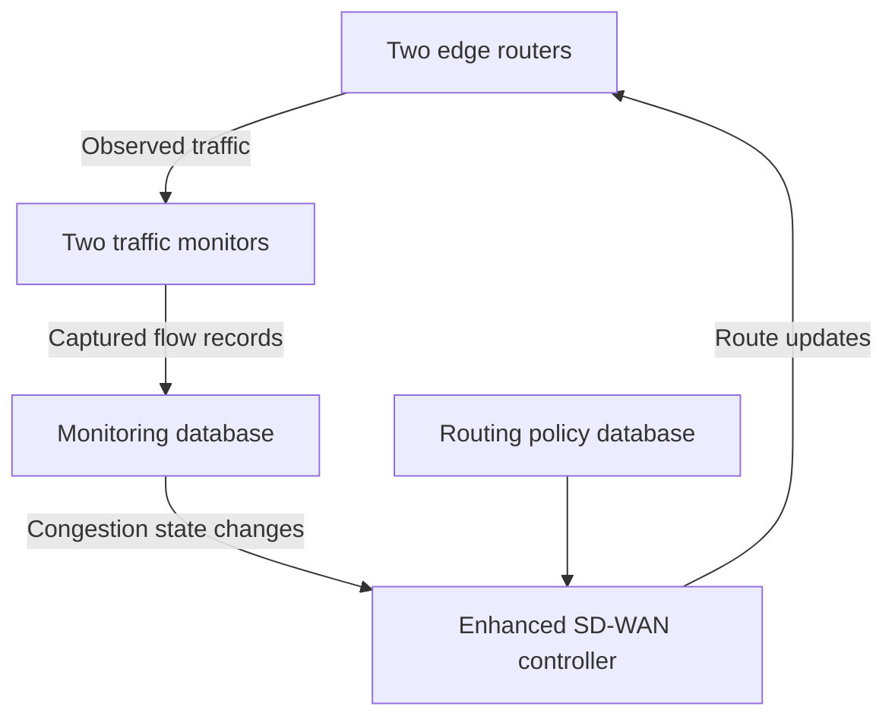

# Original architecture described in the report

Sources: sections 5.2-5.5, printed pages 77-81; sections 5.7-5.8, printed pages 86-102. PDF viewer page numbers are one greater than the printed footer numbers.

## Control relationship

This is a new schematic interpretation of the report's description, not a reproduction of a thesis figure. The two edge routers and two monitors are grouped for readability. Arrows show monitoring and control relationships, not the complete data-plane topology.

## Components

| Component | Role reported in the thesis | Source |
| --- | --- | --- |
| Traffic monitors | Capture and classify traffic at both ends; examine flow information and summarise changes in congestion | Sections 5.3, 5.5, 5.7 |
| Monitoring database | Store captured flow records and support analysis | Sections 5.3, 5.7.5 |
| Enhanced controller | Use congestion updates and available link capacity to decide whether flows should move | Sections 5.8.3-5.8.4 |
| Routing database | Maintain the routing policies and flow-to-link assignments | Sections 5.3, 5.8.4 |
| Edge routers | Apply route updates and forward traffic across the WANs | Sections 5.5, 5.8 |

The monitor implementation is described using PyShark, SQLite, time and statistics. The controller description includes socket, time, Paramiko, telnetlib and defaultdict. These are historical implementation details, not an installation requirements file for the current simulator.

The report describes inspecting packet and flow fields including IP addresses, ports, protocol, packet length, TCP window information and timestamps. It discusses congestion categories of high, medium, low and no congestion. These labels are application-level assessments, not a claim that a TCP ECN flag alone supplies the classification.

## Reported routing rule

Section 5.8.3, printed pages 99-100, gives an illustrative capacity of 100 Mbps per WAN and an 80% target. When a WAN exceeds the target, the controller considers other WANs according to remaining capacity. If no alternative can accommodate the traffic, the report says the flow remains on its congested link until conditions improve.

This differs from the portfolio simulator's weighted latency, jitter, loss, cost and utilisation score, and from its admission and drop semantics. No equivalence between the two algorithms is asserted.

## Details that require the original code

The exact congestion thresholds, timestamp matching, packet loss calculation, event ordering and device command sequences cannot be established as executable behaviour from the prose alone. The description refers both to socket communication and HTTP POST JSON updates. The original files are needed to determine the actual transport and message schema.
